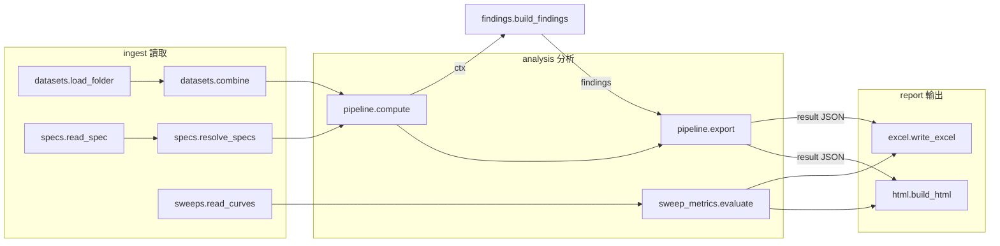

# 01 架構：分層與資料流

> analysis/、findings/、domain/families.py、domain/root_causes.py 為私有核心，不在公開 repo；以下描述介面，不描述內部邏輯。

## 一句話
**資料夾 → 讀檔 → 分析步驟 → 規則 → 報告**。每一層只呼叫比自己低的層，`tests/test_architecture.py` 會自動擋下反向 import。

## 分層

| 層 | 套件 | 職責 | 可以 import |
|---|---|---|---|
| 5 | `app/` | 視窗、命令列、一次完整分析的流程 | 全部 |
| 4 | `engine.py` | 分析入口：compute → findings → export（呼叫私有核心） | analysis、findings |
| 4 | `report/` | HTML（`web/` 前端原始碼）、Excel | analysis、domain、jsonsafe |
| 3 | `findings/` | **[私有]** 規則 → 結論、證據、root-cause 假說 | domain、config |
| 2 | `analysis/` | **[私有]** 分析步驟 | stats、domain、config、jsonsafe |
| 1 | `stats/` | 純數值統計，只吃 numpy 陣列 | config |
| 1 | `ingest/` | 讀測試資料、TestSpec、掃描曲線 | domain |
| 0 | `domain/` | 參數命名、單位（物理說明與 root-cause 庫為私有） | — |
| 0 | `config.py` `jsonsafe.py` | 門檻；JSON 安全數值 | — |

設計原則：
- **知識與計算分開**：物理說明、假說文字都在 `domain/`（私有），改文字不會碰到統計。
- **計算與判斷分開**：`analysis/` 只算數字，「這算不算問題、多嚴重」全部在 `findings/`。要調整判斷，只改規則檔。
- **門檻集中**：所有 z / q / d 門檻在 `config.py`。
- **前端與後端分開**：`report/web/` 是純 HTML/CSS/JS，Python 只負責把 JSON 塞進去。

## 資料流

## 一次分析的呼叫順序（`app/runner.py: run`）

1. `ingest.datasets.load_folder(folder)` — 每個檔案一個 `Dataset`，名稱由 WAFER_ID 自動產生
2. `ingest.datasets.combine(sets)` — 合併成一張表 + 參數清單
3. `ingest.specs.find_spec_files` → `read_spec` → `resolve_specs` — TestSpec 規則套到參數
4. `ingest.sweeps.read_curves` → `analysis.sweep_metrics.evaluate` — 掃描曲線與指標（沒有掃描檔就跳過）
5. `engine.analyse` = `pipeline.compute` → `findings.build_findings` → `pipeline.export`
6. `report.html.build_html`、`report.excel.write_excel`

## 中間資料

| 名稱 | 誰產生 | 誰使用 | 內容 |
|---|---|---|---|
| `df` | `analysis.prepare` | 所有分析步驟 | 原始欄位 + `_dataset _seq _die _x _y _session _dupxy _mkey …`（見 02） |
| `ctx` | `pipeline.compute` | `findings` 規則 | 所有步驟的結果 + df、參數資訊 |
| `result` | `pipeline.export` | `report` | 可序列化 dict，HTML 內的 `const R` 就是它 |

## 檔案地圖
完整的逐檔說明見根目錄 README 的「Repo 地圖」。
