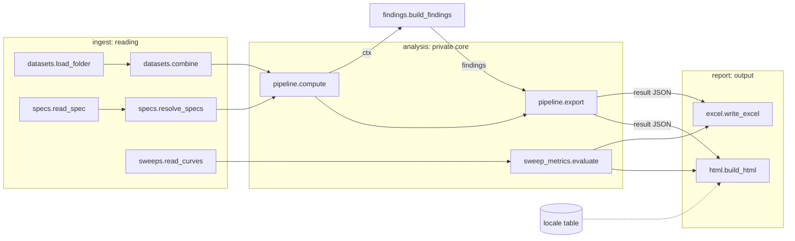

# 01 Architecture: layers and data flow

> `analysis/`, `findings/`, `domain/families.py` and `domain/root_causes.py` are the private core and are not in the public repository. This page describes interfaces, not internal logic.

## In one line
**Folder → files → analysis steps → rules → report.** Each layer only calls layers below it, and `tests/test_architecture.py` rejects any upward import.

## Layers

| Layer | Package | Responsibility | May import |
|---|---|---|---|
| 5 | `app/` | window, command line, one complete run | everything |
| 4 | `engine.py` | analysis entry: compute → findings → export (calls the private core) | analysis, findings |
| 4 | `report/` | HTML (front-end sources in `web/`), Excel | analysis, domain, jsonsafe, i18n |
| 3 | `findings/` | **[private]** rules → conclusions, evidence, root-cause hypotheses | domain, config |
| 2 | `analysis/` | **[private]** analysis steps | stats, domain, config, jsonsafe |
| 1 | `stats/` | pure numeric statistics on numpy arrays | config, i18n |
| 1 | `ingest/` | test data, TestSpec, sweep curves | domain |
| 0 | `domain/` | parameter naming and units (physics notes and the root-cause library are private) | i18n |
| 0 | `config.py` `jsonsafe.py` `i18n.py` | thresholds; JSON-safe values; message translation | — |

Design rules:
- **Knowledge apart from calculation.** Physics notes and hypothesis texts live in `domain/` (private), so editing text never touches statistics.
- **Calculation apart from judgement.** `analysis/` only computes numbers. Whether something is a problem, and how severe, is decided entirely in `findings/`. To change a judgement you edit a rule file and nothing else.
- **Thresholds in one place.** Every z / q / d threshold is in `config.py`.
- **Front end apart from back end.** `report/web/` is plain HTML / CSS / JS; Python only injects JSON.
- **English source, translated at run time.** All user-facing strings in the code are English; `i18n.py` and `T()` in the browser look them up in an optional locale file (see `pic_analyzer/locale/README.md`).

## Data flow

## Call order of one run (`app/runner.py: run`)

1. `ingest.datasets.load_folder(folder)` makes one `Dataset` per file and names it from WAFER_ID.
2. `ingest.datasets.combine(sets)` merges them into one table plus a parameter list.
3. `ingest.specs.find_spec_files` → `read_spec` → `resolve_specs` applies the TestSpec rules to the parameters.
4. `ingest.sweeps.read_curves` → `analysis.sweep_metrics.evaluate` builds sweep curves and metrics (skipped when there are no sweep files).
5. `engine.analyse` runs `pipeline.compute` → `findings.build_findings` → `pipeline.export`.
6. `report.html.build_html` and `report.excel.write_excel` write the outputs.

## Intermediate data

| Name | Produced by | Used by | Contents |
|---|---|---|---|
| `df` | `analysis.prepare` | every analysis step | original columns + `_dataset _seq _die _x _y _session _dupxy _mkey …` (see 02) |
| `ctx` | `pipeline.compute` | `findings` rules | the results of every step + df and parameter info |
| `result` | `pipeline.export` | `report` | a JSON-serialisable dict; it is `const R` inside the HTML |
| `I18N` | `i18n.table("web")` | `T()` in the browser | English → translated UI strings (empty in English) |

## File map
For every file, see the repository map in the root README.
